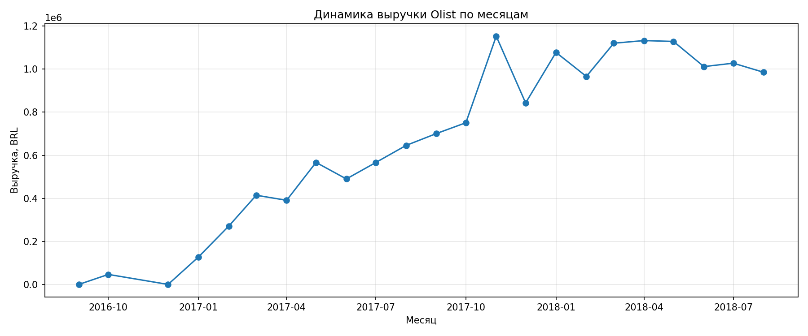
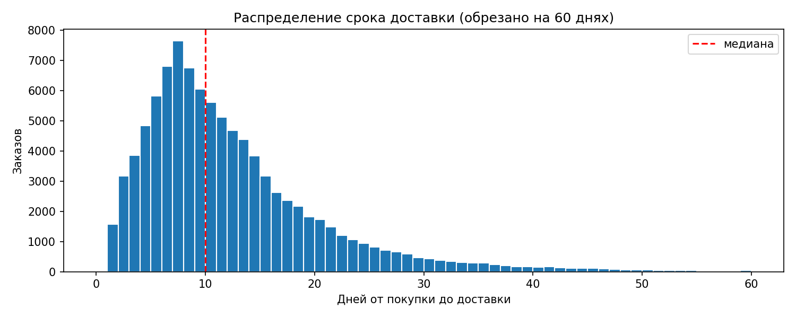
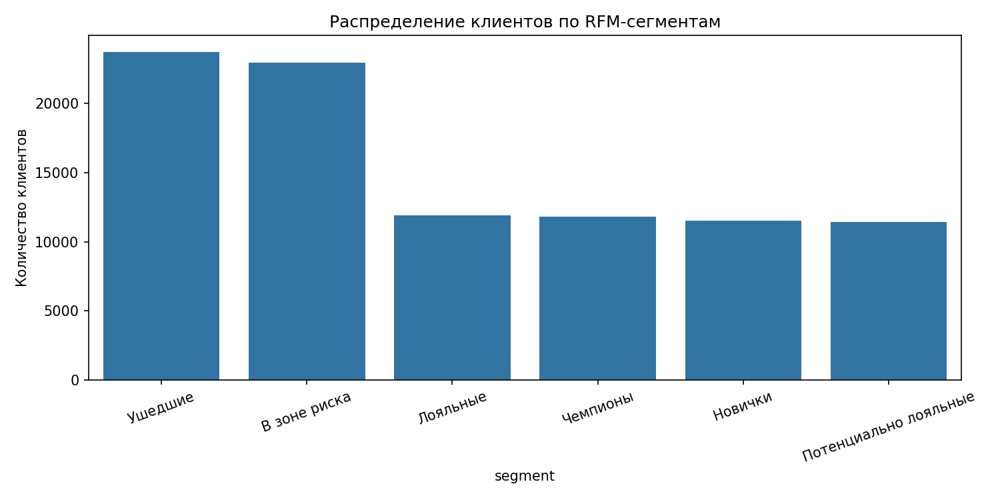

# Olist E-Commerce Analysis (SQL + Python)

Анализ бразильского маркетплейса Olist на датасете ~100 тыс. заказов (2016–2018). Проект демонстрирует навыки SQL-анализа: JOIN, CTE, оконные функции, RFM-сегментация, когортный анализ.

---

## Стек

- **Python** — pandas, matplotlib, seaborn
- **SQL** — SQLite
- **Jupyter Notebook** — анализ
- **Git** — версионирование

---

## Данные

[Brazilian E-Commerce Public Dataset by Olist](https://www.kaggle.com/datasets/olistbr/brazilian-ecommerce) (Kaggle, ~100 тыс. заказов, 9 таблиц).

Данные **не включены** в репозиторий — скачай CSV с Kaggle и положи в папку `data/`. Файл `olist.db` создаётся автоматически при первом запуске ноутбука.

---

## Вопросы, которые я исследовал

1. Как рос бизнес и где сейчас плато?
2. Какие категории и регионы дают основную выручку?
3. Как опоздания в доставке влияют на оценки клиентов?
4. Какой retention и что это значит для стратегии?
5. Какие сегменты клиентов приоритетны для возврата?

---

## Ключевые выводы

1. **Бизнес вырос, но замедлился.** Выручка росла с 127 тыс. BRL (янв 2017) до ~1.1 млн BRL/мес в 2018, но с марта 2018 — плато. Дальнейший рост нужно искать в среднем чеке и удержании, а не в привлечении новых клиентов.

2. **Логистика = клиентский опыт.** Доставка вовремя → средний рейтинг 4.29. Опоздание → 2.57. Разница 1.72 балла. 7.7% опоздавших заказов формируют основную массу оценок 1 и 2. Улучшение логистики — прямой драйвер NPS.

3. **Средние вводят в заблуждение.** Средний срок доставки 12.6 дней, медиана 10, p90 — 23, максимум — 210. Правильные KPI — медиана и p90, а не среднее.

4. **Retention критически низкий (0.2–0.7% в месяц).** Это специфика маркетплейса разовых покупок, а не проблема сервиса. Классические retention-стратегии здесь не работают — нужны категорийные триггеры.

5. **Клиенты поляризованы по чеку.** Два сегмента: ~230 BRL (Чемпионы, Лояльные, В зоне риска) и ~47 BRL (Ушедшие, Новички). Работать нужно со «В зоне риска» — 22 943 клиента с высоким чеком и низкой свежестью.

6. **Топ-10 категорий дают ~60% выручки.** Это одновременно фокус и риск. Health_beauty и watches_gifts — лидеры, но с разной моделью (массовый vs высокочековый).

7. **Кредитная карта + рассрочка = 81% выручки.** Средняя рассрочка 3.5 месяца. Boleto (19%) — важный локальный метод оплаты, его нельзя отключать.

---

## Структура проекта

```
olist_sql_analysis/
├── README.md
├── requirements.txt
├── .gitignore
├── data/                    # данные (не в репозитории)
│   └── README.md            # описание источника
├── notebooks/
│   └── sql_analysis.ipynb   # основной анализ
├── sql/                     # библиотека запросов
│   ├── 01_data_quality.sql
│   ├── 02_orders_status.sql
│   ├── 03_monthly_revenue.sql
│   ├── 04_top_categories.sql
│   ├── 05_delivery_metrics.sql
│   ├── 06_delivery_vs_reviews.sql
│   ├── 07_reviews_distribution.sql
│   ├── 08_payments.sql
│   ├── 09_top_categories_by_state.sql
│   ├── 10_rfm_segmentation.sql
│   └── 11_cohort_retention.sql
└── images/                  # графики из ноутбука
    ├── monthly_revenue.png
    ├── delivery_distribution.png
    └── rfm_segments.png
```

---

## Как запустить

1. Клонируй репозиторий:

   ```bash
   git clone https://github.com/Leekor-byte/olist_sql_analysis.git
   cd olist_sql_analysis
   ```

2. Скачай датасет с [Kaggle](https://www.kaggle.com/datasets/olistbr/brazilian-ecommerce) и распакуй CSV-файлы в папку `data/`.

3. Установи зависимости:

   ```bash
   pip install -r requirements.txt
   ```

4. Открой ноутбук `notebooks/sql_analysis.ipynb` и выполни `Kernel → Restart & Run All`. Ячейка №2 загрузит CSV в SQLite и создаст файл `olist.db`.

---

## Скриншоты

### Динамика выручки



Пик ноября 2017 — Black Friday. С марта 2018 — плато.

### Распределение сроков доставки



Правосторонний хвост: основная масса в 5–15 дней, но есть шлейф до 60+ дней. Медиана смещена влево относительно среднего.

### RFM-сегменты



Плоское распределение: 11–24 тыс. клиентов в каждом сегменте. Классическая RFM-пирамида не работает — почти все покупают один раз.

---

## Ограничения анализа

- В `order_reviews` 551 заказ с несколькими отзывами — может слегка смещать средние оценки.
- В `order_payments` 4 446 мультиоплат по `order_id` — `payments_count` ≠ `orders_count`.
- Frequency в RFM у большинства клиентов = 1, что делает F-оценку малоинформативной. Для Olist корректнее использовать бинарный признак «1 покупка / 2+ покупок».
- Данные обрезаны августом 2018 — последние когорты неполные.
- Даты хранятся как TEXT (особенность SQLite) — в продакшене нужны DATE-типы.
- Анализ описательный: причинно-следственные связи не установлены, только корреляции.